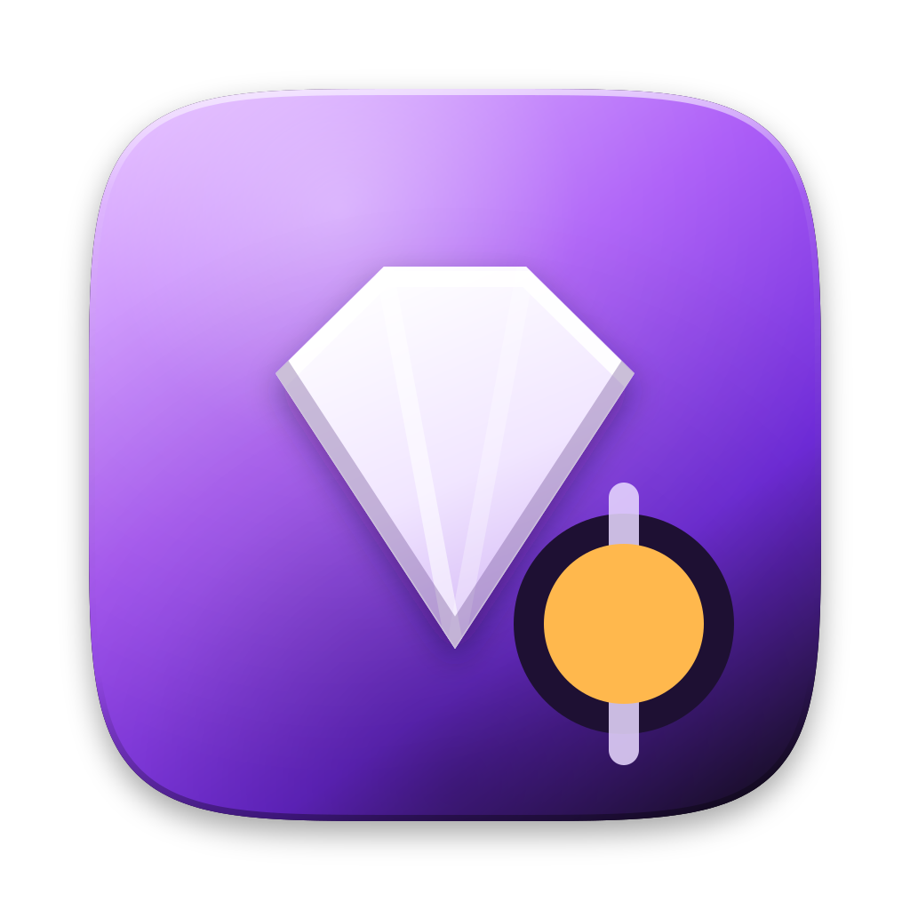
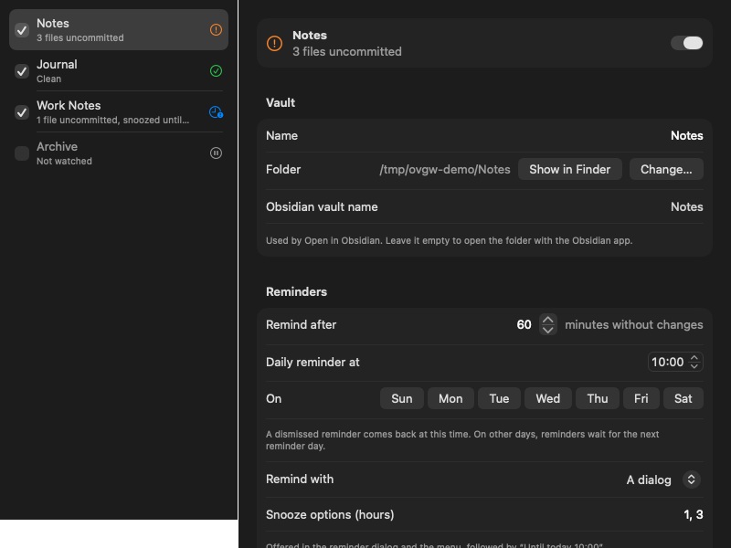
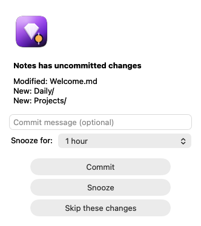
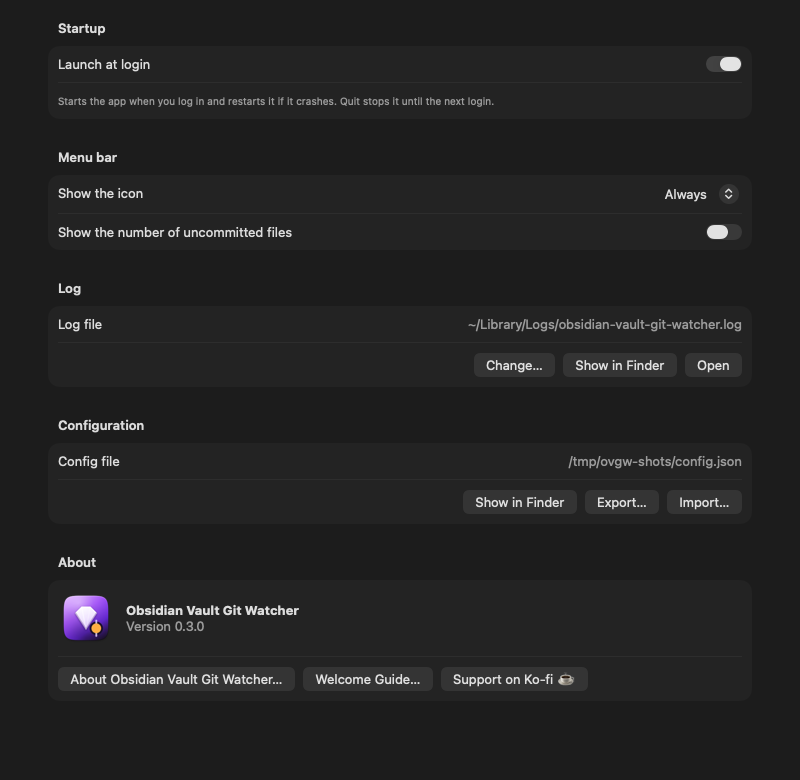

<div align="center">



# Obsidian Vault Git Watcher

### Never leave a vault uncommitted again.

A small native **macOS** menu bar app that watches your Obsidian vaults (or any git
repositories) and reminds you to commit and push once you've stopped editing. One app,
one menu bar icon, any number of vaults, each with its own schedule.

[](https://www.apple.com/macos/)
[](#requirements)
[](https://swift.org)
[](https://github.com/roypadina/ObsidianVaultGitWatcher/actions/workflows/ci.yml)
[](https://github.com/roypadina/ObsidianVaultGitWatcher/releases/latest)
[](https://github.com/roypadina/homebrew-tap)
[](https://apps.roypadina.synology.me/apps/obsidian-vault-git-watcher/)
[](LICENSE)
[](https://ko-fi.com/roypadina)
[](CONTRIBUTING.md)
[](https://github.com/roypadina/ObsidianVaultGitWatcher/stargazers)

<br>



</div>

---

## Features

- **Reminds you at the right moment.** It waits until a vault has been quiet for a while
  (default 1 hour), so there's no nag mid-edit, then shows a reminder with the changed
  files, a commit message field and **Commit**, **Snooze** and **Skip** buttons.
- **Daily fallback.** Dismiss a reminder and the next one comes at your daily reminder time
  (default 10:00, every day, or only the days you pick). Missed it while the Mac was asleep?
  It shows up on wake.
- **Commit & push in one click**, from the reminder or the menu. An empty message uses
  your template (`Vault update {date}` by default). A failed push is reported on its own:
  the commit still lands, the vault shows "N commits not pushed", and the menu gets a
  **Push** item.
- **Snooze or skip.** Snooze for 1 or 3 hours (your choice of options), a custom number of
  hours or until the next reminder time. Skip ignores exactly this set of changes until
  something changes again.
- **Any number of vaults**, each with its own settings: quiet period, reminder time and days,
  dialog or notification banner, snooze options, message template, what to stage, ignored
  paths, push on or off, remote and branch.
- **Live status** in the menu bar and in Settings: clean, files uncommitted, snoozed, skipped,
  or an error such as a missing folder or unpushed commits.
- **Native Settings window** (⌘,). Every change saves and applies immediately.
- **Lightweight.** FSEvents and exact timers, no polling. No dependencies beyond `git`.

<p align="center">
  
  &nbsp;&nbsp;
  
</p>

<p align="center">
  
</p>

## Install

```bash
brew install --cask roypadina/tap/obsidian-vault-git-watcher
```

## Requirements

macOS 14 Sonoma or later · Apple Silicon and Intel (universal binary)

Also needs `git` (the Xcode command line tools: `xcode-select --install`).

### First launch

**Not notarized.** The app is self-signed with a stable identity, so permissions survive
updates, but it has no paid Apple Developer ID, so macOS may block the first launch
("Apple could not verify…"). Open **System Settings → Privacy & Security**, scroll down and
click **Open Anyway** (right-click → Open no longer works on macOS 15+), or clear quarantine
once:

```bash
xattr -dr com.apple.quarantine /Applications/ObsidianVaultGitWatcher.app
```

Or download `ObsidianVaultGitWatcher.zip` from the
[latest release](https://github.com/roypadina/ObsidianVaultGitWatcher/releases/latest), unzip it
and move `ObsidianVaultGitWatcher.app` to `/Applications`. To build it yourself, see
[Build from source](#build-from-source).

**Updating:** `brew upgrade --cask obsidian-vault-git-watcher`, then quit the app from its menu
and open it again (the running copy keeps the old version until it restarts).

## Usage

1. Open the app. The first time, a **Welcome** window explains what it does and where the
   icon is, and has the launch-at-login switch. Click **Open Settings** to go to the
   **Vaults** tab. (Open it again any time from Settings → General → **Welcome Guide…**.)
2. Click **+** and choose your vault folder. It must be the top folder of a git repository
   with a remote (`git init` and `git remote add origin <url>` first if it isn't).
3. That's it. The menu bar icon shows the most urgent state across your vaults:

<p align="center">
  
</p>

Left to right: clean, changes waiting for a reminder, error (missing folder, not a repo,
commits not pushed), snoozed, skipped. The menu has one submenu per vault ("Notes — 3 files
uncommitted") with **Commit & push…**, **Snooze**, **Skip these changes**, **Push**, **Open
vault folder**, **Open in Obsidian** and **Vault Settings…**, then **Settings…** (⌘,),
**About**, **Support on Ko-fi ☕** and **Quit Obsidian Vault Git Watcher**.

While Settings, About or Welcome is open, the app also shows in the Dock and gets a normal
menu bar (About, Settings…, Hide, Quit, Window, and Help, which opens the
[wiki](https://github.com/roypadina/ObsidianVaultGitWatcher/wiki)), so the window can't get
lost behind other apps. It goes back to menu bar only when you close it.

### Settings

**Vaults** tab: the list on the left shows every vault with its live status and a checkbox
to watch it or not without removing it. **+** adds a vault (only a git repository with a
remote is accepted), **−** or Delete removes one after a confirmation (the folder and its
git history are never touched), drag or right-click to reorder. On the right, the selected
vault's settings:

| Setting | Default |
|---|---|
| Name (shown in the menu and dialogs) | folder name |
| Folder (Show in Finder, Change…) | |
| Obsidian vault name (for Open in Obsidian) | open the folder with the Obsidian app |
| Remind after N minutes without changes | 60 |
| Daily reminder time, and the days it may remind | 10:00, every day |
| Remind with a dialog or a notification banner | dialog |
| Snooze options (hours) | 1, 3 |
| Commit message template (`{date}` `{time}` `{files}` `{vault}`) | `Vault update {date}` |
| Stage all changes, or only files git already tracks | all |
| Ignored paths (relative to the vault, `*` and `**` work) | `.obsidian/workspace*.json`, `.stversions`, `.stfolder` |
| Push after committing; remote and branch | on; the branch's upstream |

A field that doesn't validate shows the problem under it and isn't saved until fixed.

**General** tab: launch at login, the menu bar icon (always, or only when a vault needs
attention; optional count of uncommitted files), the log file, the config file with
**Export…** / **Import…**, and About, where **Welcome Guide…** reopens the welcome window.

More in the [wiki](https://github.com/roypadina/ObsidianVaultGitWatcher/wiki): every setting,
the config file format, troubleshooting and the FAQ.

## What gets committed

The commit action stages **everything** in the vault (`git add -A`): new, changed and
deleted files, minus the vault's ignored paths and whatever its `.gitignore` excludes.

> [!WARNING]
> **Never keep secrets (API keys, passwords, tokens) in a vault you let this app commit.**
> They end up in the git history and on your remote, and removing them later means
> rewriting history.

Two settings narrow what is staged: **Ignored paths** (changes there never trigger a
reminder and are never committed) and **Stage: only files git already tracks**
(`git add -u`: new files are left out until you add them yourself).

## Permissions

None to grant up front. macOS may ask once whether the app can access a folder (for example
when a vault lives in Documents or iCloud Drive), because it runs `git` there. Pushing uses
your normal git setup (SSH keys or the credential helper); the app never sees or stores
credentials.

## Limitations

- The reminder is a dialog or a notification banner; the banner has no buttons (use the
  menu to commit).
- After `brew upgrade` the running copy keeps the old version until you quit and reopen it.
- One app instance watches every vault; it does not merge, pull or resolve conflicts.
- Not affiliated with Obsidian. It works with any git repository.

## Privacy

Everything runs on your Mac. The app makes no network connections of its own; the only
traffic is the `git push` you configure, to your own remote. No analytics, no telemetry.

## Build from source

```bash
git clone https://github.com/roypadina/ObsidianVaultGitWatcher.git
cd ObsidianVaultGitWatcher
./install.sh
```

`install.sh` builds the app with `swiftc` (no Xcode project, no third-party dependencies),
installs it to `/Applications`, installs the LaunchAgent and starts it. Re-run it after every
change. `./build.sh` alone builds `build/ObsidianVaultGitWatcher.app` without installing;
`./build.sh dist` also makes the release zip. A build you make yourself isn't quarantined, so
Gatekeeper doesn't prompt.

`--selftest` runs the test suite (scheduling, config, every vault setting, against throwaway
git repos). Details, debug flags and how to test against a throwaway config are in
[Building from source](https://github.com/roypadina/ObsidianVaultGitWatcher/wiki/Building-from-source).

## Uninstall

```bash
brew uninstall --zap --cask obsidian-vault-git-watcher
```

`--zap` also removes the config, state files, log and the LaunchAgent. Without Homebrew: quit
the app, then

```bash
launchctl bootout gui/$(id -u)/com.roypadina.obsidian-vault-git-watcher
rm -f ~/Library/LaunchAgents/com.roypadina.obsidian-vault-git-watcher.plist
rm -rf /Applications/ObsidianVaultGitWatcher.app "$HOME/Library/Application Support/ObsidianVaultGitWatcher"
```

## Feature requests and contributions

Have an idea for Obsidian Vault Git Watcher? [Request a feature](https://github.com/roypadina/ObsidianVaultGitWatcher/issues/new?template=feature_request.yml) and say what you're trying to do; that matters more than the exact feature. Found a bug? [Report it](https://github.com/roypadina/ObsidianVaultGitWatcher/issues/new?template=bug_report.yml).

Code is welcome too: small, focused pull requests, and an issue first for anything bigger. See [CONTRIBUTING.md](CONTRIBUTING.md).

Tipped on [Ko-fi](https://ko-fi.com/roypadina)? Add your Ko-fi name to the request and it goes to the front of my queue. It's a thank-you, not a purchase: no promise on what ships or when.

## More Mac apps by Roy

Free, open-source Mac menu-bar apps and terminal tools, all on one site: **[apps.roypadina.synology.me](https://apps.roypadina.synology.me/)**.

- [VaultBar](https://apps.roypadina.synology.me/apps/vaultbar/) — Your encrypted vaults, one click from the menu bar.
- [MeetAlert](https://apps.roypadina.synology.me/apps/meetalert/) — Meeting alerts you can't miss: a popup that stays, a phone push that escalates.
- [Window Organizer](https://apps.roypadina.synology.me/apps/window-organizer/) — Clear the desk in one keystroke.
- [LanGuard](https://apps.roypadina.synology.me/apps/languard/) — Wi-Fi off when you're wired. Back on when you're not.

## Support

If Obsidian Vault Git Watcher keeps your notes safely pushed, you can support its development —
it's optional and always appreciated.

[](https://ko-fi.com/roypadina)

A ⭐ on the repo helps just as much.

## License

[MIT](LICENSE) © Roy Padina
